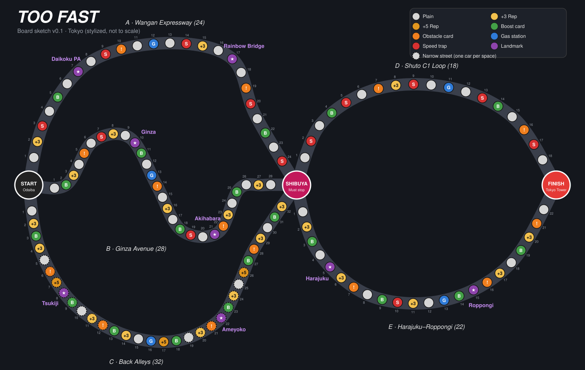

# Too Fast — Board Layout (Draft v0.1)



The sketch is generated from the route lists below by [tools/make_board.py](tools/make_board.py). To change a space, edit that route's `seq` line in the script and run:

```bash
python3 tools/make_board.py
```

The map is a **stylized** Tokyo, not a real map. Landmarks are roughly in the right part of town, but distances are made up for gameplay.

---

## Overall shape

```
                    A · Wangan Expressway (24)
              ┌──────────────────────────────────┐          D · Shuto C1 Loop (18)
              │                                  │        ┌────────────────────────┐
  START ──────┼──── B · Ginza Avenue (28) ───────┼── SHIBUYA                       ├── FINISH
 (Odaiba)     │                                  │ CROSSING └────────────────────────┘  (Tokyo Tower)
              └──────────────────────────────────┘          E · Harajuku–Roppongi (22)
                    C · Back Alleys (32)
```

| Path | Total spaces | Notes |
|---|---|---|
| A → D (fastest) | 42 | 10 speed traps. Very hard to pull off without a Police Scanner. |
| A → E | 46 | |
| B → D | 46 | |
| B → E | 50 | The "balanced" line |
| C → D | 50 | The intended "build up, then blast" line |
| C → E | 54 (longest) | Earns the most Rep |

With an average move of about 4–5 spaces, a race takes roughly **10–12 turns per player**. That should land in the 30–45 minute target.

## Space key

| Code | Space | Color on sketch |
|---|---|---|
| · | Plain | grey |
| +3 | Gain 3 Rep | yellow |
| +5 | Gain 5 Rep (alleys only) | dark gold |
| B | Draw a Boost card | green |
| ! | Draw an Obstacle card | orange |
| G | Gas station (refuel to 5) | blue |
| S | Speed trap | red |
| ★ | Landmark | purple |
| dashed outline | Narrow street (one car per space) | |

---

## Leg 1: Odaiba → Shibuya Crossing

### A · Wangan Expressway (24 spaces)
*Fast and wide open. The police know it too.*

| 1 | 2 | 3 | 4 | 5 | 6 | 7 | 8 | 9 | 10 | 11 | 12 |
|---|---|---|---|---|---|---|---|---|---|---|---|
| · | +3 | **S** | · | B | · | ★ Daikoku PA | · | **S** | ! | · | G |

| 13 | 14 | 15 | 16 | 17 | 18 | 19 | 20 | 21 | 22 | 23 | 24 |
|---|---|---|---|---|---|---|---|---|---|---|---|
| · | **S** | +3 | · | ★ Rainbow Bridge | · | ! | **S** | · | B | · | **S** |

5 speed traps · 2 Rep · 2 Boost · 2 Obstacle · 1 gas station

### B · Ginza Avenue (28 spaces)
*Bright lights, busy streets, a bit of everything.*

| 1 | 2 | 3 | 4 | 5 | 6 | 7 | 8 | 9 | 10 | 11 | 12 | 13 | 14 |
|---|---|---|---|---|---|---|---|---|---|---|---|---|---|
| · | B | +3 | · | ! | · | **S** | +3 | · | ★ Ginza | B | · | G | ! |

| 15 | 16 | 17 | 18 | 19 | 20 | 21 | 22 | 23 | 24 | 25 | 26 | 27 | 28 |
|---|---|---|---|---|---|---|---|---|---|---|---|---|---|
| · | +3 | · | B | **S** | · | ★ Akihabara | ! | +3 | · | B | · | +3 | · |

2 speed traps · 5 Rep · 4 Boost · 3 Obstacle · 1 gas station

### C · Back Alleys (32 spaces)
*Slow, twisty and full of street cred. No police back here. Spaces 5–12 and 19–26 are **narrow**.*

| 1 | 2 | 3 | 4 | 5 | 6 | 7 | 8 | 9 | 10 | 11 | 12 | 13 | 14 | 15 | 16 |
|---|---|---|---|---|---|---|---|---|---|---|---|---|---|---|---|
| · | +3 | B | +3 | · | ! | +5 | ★ Tsukiji | B | · | G | ! | B | +3 | · | G |

| 17 | 18 | 19 | 20 | 21 | 22 | 23 | 24 | 25 | 26 | 27 | 28 | 29 | 30 | 31 | 32 |
|---|---|---|---|---|---|---|---|---|---|---|---|---|---|---|---|
| +5 | B | · | +3 | ! | ★ Ameyoko | B | G | · | +5 | B | ! | +3 | · | B | +3 |

0 speed traps · 9 Rep spaces (3 of them +5) · 7 Boost · 4 Obstacle · 3 gas stands (the alleys are slow, so they get extra fuel stops)

---

## ★ Shibuya Crossing (hub)

- Every car **must stop** here. Leftover movement is lost.
- **Fill your fuel to 5.**
- The **first car to arrive** gains **3 Rep**.
- No duels here.
- On your next turn, choose route D or E.

---

## Leg 2: Shibuya Crossing → Tokyo Tower

### D · Shuto C1 Loop (18 spaces)
*The legendary inner loop. Short, fast and crawling with cops.*

| 1 | 2 | 3 | 4 | 5 | 6 | 7 | 8 | 9 |
|---|---|---|---|---|---|---|---|---|
| · | **S** | · | B | **S** | · | ! | +3 | **S** |

| 10 | 11 | 12 | 13 | 14 | 15 | 16 | 17 | 18 |
|---|---|---|---|---|---|---|---|---|
| · | G | · | **S** | B | · | ! | **S** | · |

5 speed traps · 1 Rep · 2 Boost · 2 Obstacle · 1 gas station

### E · Harajuku–Roppongi (22 spaces)
*Longer, but the crowds love a show.*

| 1 | 2 | 3 | 4 | 5 | 6 | 7 | 8 | 9 | 10 | 11 |
|---|---|---|---|---|---|---|---|---|---|---|
| · | +3 | B | · | ★ Harajuku | +3 | ! | · | B | **S** | +3 |

| 12 | 13 | 14 | 15 | 16 | 17 | 18 | 19 | 20 | 21 | 22 |
|---|---|---|---|---|---|---|---|---|---|---|
| · | G | B | ★ Roppongi | ! | +3 | · | B | +3 | ! | · |

1 speed trap · 5 Rep · 4 Boost · 3 Obstacle · 1 gas station

### 🏁 Tokyo Tower (finish)
The first car to reach or pass it wins.

---

## Landmarks

| Landmark | Route | When you land here |
|---|---|---|
| **Daikoku PA** | A7 | *The famous car meet.* You may buy one upgrade at **2 Rep off** (minimum cost 1). |
| **Rainbow Bridge** | A17 | *Toll shortcut.* You may pay 2 Rep to move forward 4 spaces (to A21). |
| **Ginza** | B10 | *Luxury shopping.* You may pay 1 Rep to draw 2 Boost cards and keep 1. |
| **Akihabara** | B21 | *Hack the traffic lights.* Move any other car back 2 spaces. |
| **Tsukiji Market** | C8 | *Stuck behind a fish truck.* Gain 3 Rep, but get −1 to your next roll. |
| **Ameyoko (Ueno)** | C22 | *Lose yourself in the market crowd.* Reset your Heat to 0. |
| **Shibuya Crossing** | hub | Must stop, refuel to 5. First car to arrive gets +3 Rep. |
| **Harajuku** | E5 | *Show off your ride.* Gain 1 Rep for each upgrade you own. |
| **Roppongi** | E15 | *Nightlife crowd.* Gain 1 Rep for each car behind you, and +1 Heat. |

## Placement rules (for when you redesign the map)

- **Don't put a speed trap right after a landmark that moves you forward.** It feels like a trap in the bad sense.
- **Keep fuel stops 16 spaces apart or less.** Start, Shibuya and gas stations all count. A full tank (5 turns) carries a car with no upgrades about 17 spaces, so a longer gap means players run out all the time. Today's gaps are 5–13 spaces, except Ginza Avenue's last stretch (16), which is the tightest.
- **Every route needs at least one gas station,** so *Flat Tire* can always be fixed.
- **Gas stations go in the middle of a route,** not near the start. That way running out of gas actually sends you back.
- **Keep Plain spaces at about 25–40%.** Too few and every turn is busy. Too many and turns feel empty.
- **Oil slicks can only go on Plain spaces.** More Plain spaces on a route means more room for sabotage.

## Ideas for a nicer final board

- Draw the routes over a dark, neon-lit Tokyo map with the bay at the bottom.
- Make the Rainbow Bridge an actual bridge graphic over the water.
- Put the speed traps behind small police-car icons.
- Show Shibuya Crossing as the famous scramble crossing seen from above.
- Make Tokyo Tower a big red-and-white illustration in the finish corner.
