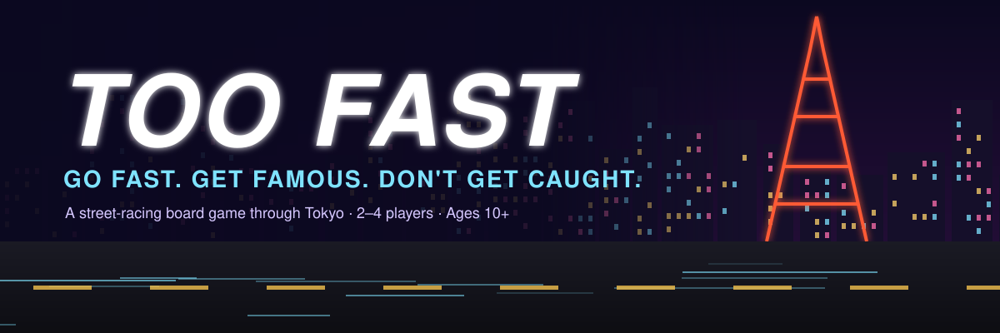
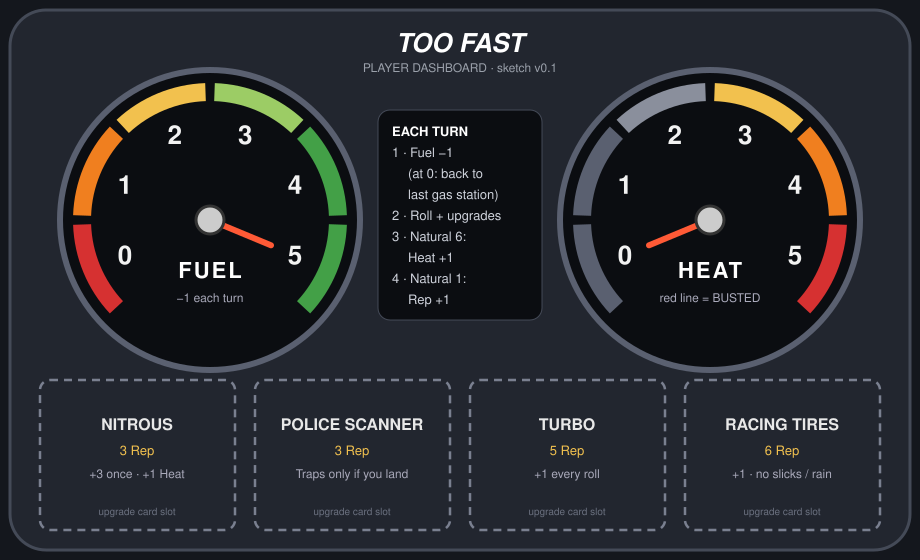
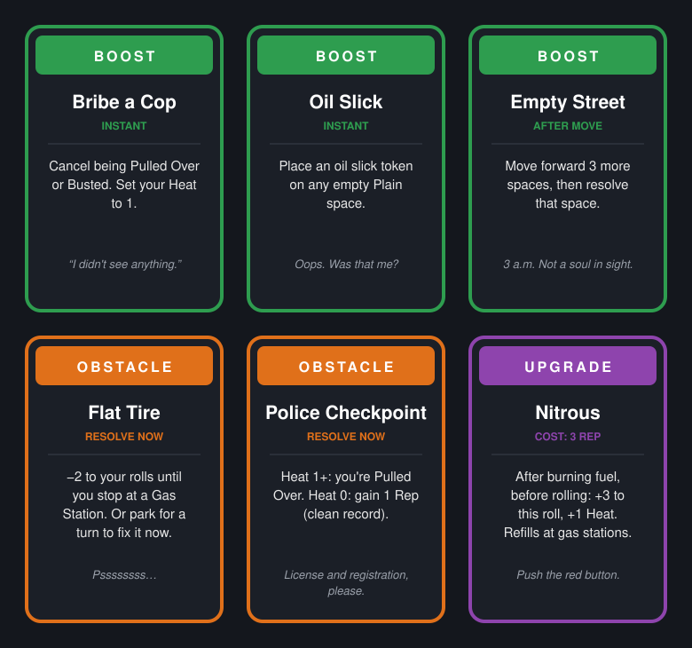

<p align="center">
  
</p>

<h3 align="center">Go fast. Get famous. Don't get caught.</h3>

<p align="center">
  <b>2–4 players</b> · <b>Ages 10+</b> · <b>30–45 minutes</b> · <i>Prototype in development</i>
</p>

---

**Midnight in Tokyo. The streets are empty, the neon is bright, and the race is on.**

*Too Fast* is a street-racing board game. Race from the Odaiba waterfront, through the chaos of Shibuya Crossing, to the finish line at Tokyo Tower. The first car there wins. But push too hard and the police will notice, forget to fill up and you'll be pushing your car back to the last gas station, and your rivals are always one oil slick away from ruining your night.

## Why you'll love it

- 🛣️ **Real route choices.** Three roads to Shibuya and two to the finish, each with its own risks and rewards.
- 🔧 **Build your ride.** Spend Reputation on a Turbo, Racing Tires, a Police Scanner or Nitrous, and slot each one into your dashboard.
- ⛽ **Two gauges, one choice.** Fuel pushes you to hurry. Heat pushes you to slow down. You can't ignore either one.
- 🚓 **Push your luck.** Speed traps catch drivers who go too fast, and hitting the red line on your Heat dial gets you Busted.
- 🛢️ **Play dirty.** Drop oil slicks, hack traffic lights in Akihabara, block narrow alleys, and win Street Duels.
- ⚖️ **Tested for balance.** The rules have been run through **20,000-game bot simulations**, so no single route or strategy runs away with the game.

---

## The board

<p align="center">
  
</p>

The race runs in **two legs**. **Shibuya Crossing** sits in the middle, and every car must stop there and refuel.

| Leg | Route | Spaces | Character |
|---|---|---|---|
| 1 | 🏎️ **Wangan Expressway** | 24 | The fastest road, but it's crawling with speed traps. Has the Daikoku PA car meet and the Rainbow Bridge shortcut. |
| 1 | 💡 **Ginza Avenue** | 28 | Bright lights and a bit of everything. |
| 1 | 🏮 **Back Alleys** | 32 | Slow and twisty, but full of Reputation. No police, and narrow streets for blocking rivals. |
| 2 | 🌀 **Shuto C1 Loop** | 18 | Short, fast and swarming with cops. |
| 2 | 🎌 **Harajuku–Roppongi** | 22 | Longer, but the crowds love a show. |

**Landmarks along the way:** Daikoku PA · Rainbow Bridge · Ginza · Akihabara · Tsukiji Market · Ameyoko · Shibuya Crossing · Harajuku · Roppongi · Tokyo Tower

## Your dashboard

<p align="center">
  
</p>

Each player holds a **car dashboard** with everything about their car on one card:

- **⛽ Fuel gauge (5 → 0):** turn it down 1 every turn you drive. Refill at gas stations and Shibuya. Run dry and you push back to the last station.
- **🔥 Heat tachometer (0 → 5):** natural 6s, Nitrous and showing off push the needle up. **Hit the red line and you're Busted.**
- **🔧 Four upgrade slots:** buy an upgrade and slide it into its slot.

| Upgrade | Cost | What it does |
|---|---|---|
| **Nitrous** | 3 Rep | +3 to one roll and +1 Heat. Refill at gas stations. |
| **Police Scanner** | 3 Rep | Speed traps only catch you if you land on them. |
| **Turbo** | 5 Rep | +1 to every roll |
| **Racing Tires** | 6 Rep | +1 to every roll. Immune to oil slicks and rain. |

## The cards

<p align="center">
  
</p>

- **25 Boost cards (green):** keep them in your hand and play them at the right moment. Bribe a cop, find an empty street, take a shortcut, or drop an oil slick on a rival.
- **25 Obstacle cards (orange):** draw one and it happens right away. Flat tires, traffic jams, police checkpoints, rival crews.
- **16 Upgrade cards (purple):** permanent improvements for your car.

The full list is in [CARDS.md](CARDS.md).

---

## How to play (quick version)

**Goal:** be the first car to reach or pass Tokyo Tower.

**Setup:**
1. Every car starts at Odaiba with a full tank (5) and 0 Heat.
2. Everyone takes 4 Reputation. Players 3 and 4 get +1 and +2 extra for going later.

**On your turn:**

1. **🔧 Before you roll:** buy upgrades and play Boost cards.
2. **🎲 Burn fuel and roll:** turn your fuel gauge down 1, fire Nitrous if you want, then roll a six-sided die and add your upgrades.
   - Rolled a **6**? +1 Heat.
   - Rolled a **1**? +1 Rep for keeping it cool.
3. **🏁 Move and resolve:** move forward, then do what your space says. You might earn Rep, draw a card, refuel, visit a landmark, or get pulled over.
4. **⚔️ Clash:** if you end on another car's space, you have a Street Duel. Both players roll, and the winner takes 2 Rep.

**🚓 The police:**
- **Getting caught:** you're caught if you **land** on a speed trap, or **blast past** one with 7+ movement.
- **Fines:** you pay Rep equal to your Heat. At Heat 0 you just get a warning.
- **Busted:** reach Heat 5 and you lose your next turn.

**⛽ Fuel:**
- **Burning:** each turn you drive costs 1 fuel.
- **Refilling:** gas stations and Shibuya fill you back up to 5.
- **Running out:** at 0, you push your car back to the nearest gas station behind you.

The complete rulebook is in [RULES.md](RULES.md).

---

## What's in the box

- 1 game board
- 4 race cars
- 4 player dashboards with spinning fuel and Heat dials
- 25 Boost cards, 25 Obstacle cards, 16 Upgrade cards
- Reputation chips
- 6 oil slick tokens
- Dice
- Rulebook

## Balanced by simulation

Before a single paper playtest, *Too Fast* was played **hundreds of thousands of times by bots**. The simulator is written in Go and lives in this repo. It tried 8 play styles, every route, and more than 20 rule changes. The v0.3 rules came out of that work:

| | Before (v0.2) | Now (v0.3) |
|---|---|---|
| Win rate range across real play styles | 8% – 45% | 27% – 36% |
| Win rate range across routes | 9% – 42% | 22% – 31% |
| Seat 1 vs seat 4 win rate | 30% vs 20% | 26% vs 28% |
| Games where a player got stuck for 3+ turns | 0.1% | 0.1% |

The full findings are in [SIMULATION.md](SIMULATION.md).

---

## Project files

| File | What's in it |
|---|---|
| [RULES.md](RULES.md) | The complete rulebook (v0.3) |
| [CARDS.md](CARDS.md) | Every card, with effects and flavor text |
| [BOARD.md](BOARD.md) | The board, space by space, plus landmark effects |
| [IDEA.md](IDEA.md) | Design notes, parts list and open playtest questions |
| [BOX.md](BOX.md) | Front and back box copy |
| [SIMULATION.md](SIMULATION.md) | Balance findings from the simulator |

### For designers and tinkerers

All the images here are generated from code, so they always match the rules:

```bash
python3 tools/make_board.py
```

```bash
python3 tools/make_dashboard.py
```

```bash
python3 tools/make_promo.py
```

These draw, in order, the board, the dashboard, and the banner plus the sample cards.

Run the balance simulator (requires Go 1.27+):

```bash
go run ./cmd/sim
```

Watch one bot game play out, turn by turn:

```bash
go run ./cmd/sim -trace -seed 7
```

## Status

*Too Fast* is a **prototype**. The rules are at v0.3, and paper playtesting is next.

**Want to help playtest?** Print the board and cards, grab four toy cars, and [open an issue](https://github.com/jjamieson1/too-fast/issues) with how your race went.

<p align="center"><i>Drive fast. Not too fast.</i> 🏁</p>
